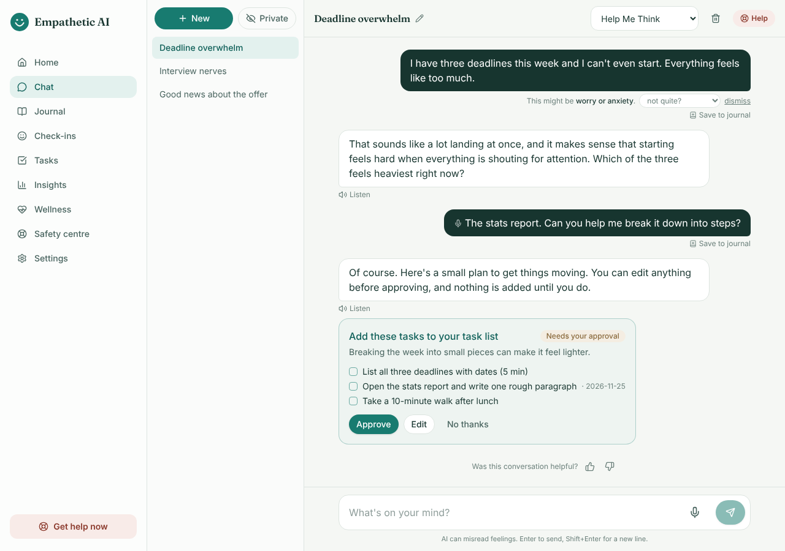

# Empathetic AI

A safety-constrained, emotion-aware AI companion for everyday well-being. People can type or speak what they're going through, feel heard, notice patterns, and turn everyday problems into small steps. They stay in control of their data the whole time.

> **Research prototype.** Not a clinical service. It does not diagnose, treat or monitor anyone, and it never contacts anyone automatically.



## What it does

- **Seven conversation modes**: Just Listen, Help Me Think, Problem Solver, Motivate Me, Self-Reflection, Casual Companion and Calm Me Down. Mode rules are enforced in code, not only in the prompt.
- **Emotion and intent engine**: a TF-IDF + Logistic Regression baseline trained on GoEmotions (ported to TypeScript, parity-tested against scikit-learn), an optional DistilRoBERTa transformer, and LLM zero-shot signals. They are combined with weighted late fusion. The engine abstains when it isn't sure, and the user's correction always wins.
- **Independent safety layer**: a deterministic policy screens every message before any model runs, and checks every draft reply. The LLM can only escalate the route. High-risk replies come from reviewed templates. Help resources are one tap away on every screen, and also signed out at `/help`.
- **Agentic actions with approval**: the assistant can propose task plans, journal entries or memories. Nothing is written until the user reviews, edits and approves. Execution is a single idempotent database transaction.
- **Voice input**: explicit start, stop and cancel, then an editable transcript (Whisper via Groq). Raw audio is never stored.
- **Reflection**: daily check-ins, a journal with AI summary drafts, and insights that follow strict data rules (no zero-filling, at least 3 days, observations rather than causes, no wellbeing score).
- **Privacy**: private chats that are never stored, memory that is off until opted in, separate consents, JSON and text export, full account deletion, Row Level Security on every table.

## Stack

Next.js 16 (App Router, TypeScript, Tailwind v4) · Supabase (Postgres, Auth, RLS) · Groq (OpenAI-compatible LLM + Whisper) · optional Hugging Face Inference · scikit-learn (offline training) · Vitest · PGlite · Vercel

```
apps/web/                 Next.js app (UI + /api/v1 route handlers)
  src/lib/safety/         policy, reviewed templates, verified resources
  src/lib/emotion/        TF-IDF+LR runtime, fusion, transformer adapter, intent
  src/lib/ai/             orchestrator state machine, strategy, prompts, LLM/STT adapters
  tests/                  unit + integration tests (safety, emotion, orchestrator, insights)
  scripts/check-migration.mjs   runs migrations in PGlite and checks RLS/idempotency
services/ml/              training + evaluation for the text baseline
supabase/migrations/      schema, RLS policies, approval RPC, sample-data RPCs
docs/                     handbook, research book, traceability, screenshots
```

## Quick start (local)

```bash
cd apps/web
npm install
cp .env.example .env.local      # add your Supabase URL + keys (LLM key optional)
npm run dev                     # http://localhost:3000
```

Run `supabase/setup.sql` (all migrations in one script) in the Supabase SQL editor first. Without an LLM key the app runs in a clearly labelled **demo mode**. The full walkthrough, including Vercel deployment, is in [docs/HANDBOOK.md](docs/HANDBOOK.md).

## Quality checks

```bash
cd apps/web
npm run verify     # lint + typecheck + 49 tests + database checks + production build
```

| Check | Result at handoff |
| --- | --- |
| Unit and integration tests (Vitest) | 49 / 49 passing |
| Migration, RLS, idempotency, keep-alive and cascade checks (PGlite) | 14 / 14 passing |
| TypeScript | no errors |
| ESLint | 0 errors (11 warnings for intentional data-loading effects) |
| `next build` | succeeds |

Text baseline on the GoEmotions test split (7 classes): **macro-F1 0.467**, accuracy 0.617, calibration error 0.094 → 0.040 after temperature scaling. Full numbers are in [docs/RESEARCH_BOOK.md](docs/RESEARCH_BOOK.md#6-emotion-and-intent-engine).

## Always on

A daily Vercel cron (`apps/web/vercel.json` → `/api/v1/keepalive`) touches the database so the free Supabase project never pauses, and removes guest accounts older than 30 days. The LLM adapter walks a chain of free Groq models when one hits its daily quota, and falls back to the deterministic responder if all are busy. Safety routing never depends on the LLM.

## Docs

- [Deployment handbook](docs/HANDBOOK.md): accounts, keys, database, Vercel, troubleshooting
- [Research book](docs/RESEARCH_BOOK.md): the what, how and why, results, limitations, interview prep
- [Requirements traceability](docs/TRACEABILITY.md): every PRD requirement mapped to code and tests

## Limitations

The safety policy and response templates have **not** had clinical review. The crisis resources were checked on 24 Nov 2026 and must be re-verified on a schedule. The fusion weights for the transformer and LLM signals are provisional until they are evaluated on the same held-out split. Audio emotion recognition is not included. See the research book for the full list.
